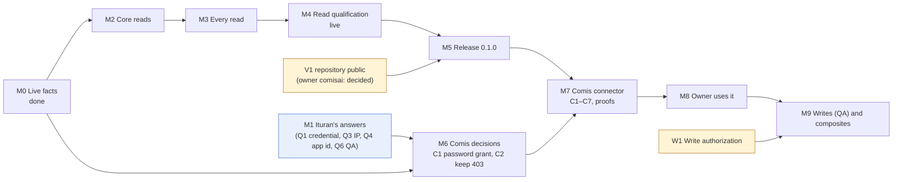
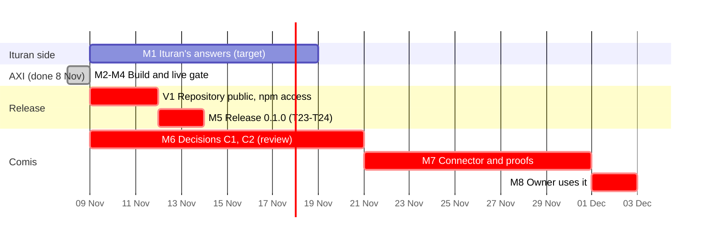

# ituran-axi: master plan

| | |
| --- | --- |
| Status | `ituran-axi` is built and passes the live gate on production (`--strict --deep --parity --use-cases`, S1 to S14, 2026-11-08). That includes the owner's 126 questions: 117 answered, and 9 that name the temperature service this account lacks. Release waits on making the repository public (V1). C1, C2 and C3 are built in Comis and in review: [PR #3617](https://github.com/comisai/comis/pull/3617) (C2, D3617) and [PR #3630](https://github.com/comisai/comis/pull/3630) (C1, D3630, and C3). |
| Date | 2026-11-08 |
| Design | `ituran-axi-design.md` |
| Implementation plan | `ituran-axi-implementation-plan.md` (tasks T1 to T28, test plan) |
| Live test | `test/live/ituran-live.mjs`; reports in `test/live/reports/` (gitignored) |

## 1. Goal

A Comis worker can answer the owner's questions about their vehicles: where they are, where they went, who drove, what happened, and how they are driven. It reads Ituran through `ituran-axi`, and the workbench never holds the Ituran password or a token. `ituran-axi` replaces `ituran-mcp` for Comis and for any agent with a shell. It does so with 23 commands in place of 152 tools.

**Done means all five of these hold:**
1. `ituran-live --strict --deep --parity` passes S1 to S13 on production.
2. `ituran-axi` 0.1.0 is on npm with signed provenance.
3. The Comis decision records for C1 (Gate password grant) and C2 (keep Ituran's 403) are accepted.
4. The Comis proofs in design §13 pass, and `pnpm gate` is green on the branch.
5. The owner has asked their chief of staff a real question about their vehicles, and the answer came through Comis.

## 2. Status board

Updated 2026-11-08 from the live runs in `test/live/reports/2026-11-08T*.json`.

| Area | Status | Evidence |
| --- | --- | --- |
| Network and TLS to `api.ituran.com` | **Done** | S2, with Node's own CA store |
| Sign-in: password grant, refresh, 24-hour token | **Done** | S3, S4 |
| Account and zone | **Done** | S5: `Israel Standard Time`, mapped to `Asia/Jerusalem` |
| Read families the AXI needs | **Done** | S6, S9, S9b: 16 available |
| Error shapes | **Done** | S2, S8, S6: 400 for a missing header, 401, 403 `1020`, `1006` and `403.2`, 400 `1000` and `1032`, 404 |
| Draft Gate entry against real traffic | **Done** | S13: every AXI route credentialed as a read; identity, commands and writes denied |
| Parity reference (`ituran-mcp` 4.2.0) | **Done** | S12: same vehicle total |
| AXI code | **Done** | All 24 commands. 62 tests pass on the source, and 43 of them on the built package. |
| Live AXI qualification | **Done** | S11: 26 runs of the built AXI on production; S12 parity; S13 Gate rules |
| Owner questions (`USER-PROMPTS.md`) | **Done** | S14: 126 questions, 124 commands. 117 answered, and 9 name ITC, which this account lacks. The first runs found F18 to F20. |
| Gate sign-in wire (C1) | **Done** | `--form-grant`: production accepts the grant as the Gate sends it (F21) |
| Comis bundle | **Drafted and tested here** | `comis/`: catalog entry, skill and recipes, wrapper, C1 and C2 drafts; `test/contract/comis-bundle.test.ts` |
| Not entitled on this account | Known | ITC (`1006`), advanced alerts (403), event types (`1032`), drive-permission groups (`403.2`) |
| Writes | Not planned for 0.1.0 | No QA account, no authorization (W1) |
| Comis connector | **In review** | [PR #3617](https://github.com/comisai/comis/pull/3617): the proposal and C2 (D3617). [PR #3630](https://github.com/comisai/comis/pull/3630), stacked on it: C1 (D3630) and the C3 catalog entry, with failure-mode tests and mutation rows. The pack, skill and proofs (C4 to C7) wait on M5. |

## 3. Workstreams

| ID | Workstream | Who | Scope |
| --- | --- | --- | --- |
| A | Ituran side | Owner, with Ituran | Questions Q1, Q3, Q4 and Q6 (§7): a non-password credential, IP allowlisting, an app id, a QA account |
| B | AXI build | Developer | Implementation plan T1 to T19, T22 and T23 |
| C | Live qualification | Developer, with the owner's authorization | T13, T20, T21, T24 |
| D | Comis connector | Developer, with Comis reviewers | C1 to C7 and the design §13 proofs; bundle T25 and T26 |
| E | Later | Developer and owner | Phase 3 writes on QA (C8), phase 4 composites by demand |

## 4. Milestones and gates

A milestone is done only when its gate passes. Every gate is a command or a proof.

| ID | Milestone | Stream | Depends on | Exit gate | Status |
| --- | --- | --- | --- | --- | --- |
| M0 | Live facts | C | — | `ituran-live` passes S1 to S10 and S13 on production | **Done 2026-11-08** |
| M1 | Ituran's answers | A | — | Q1, Q3, Q4 and Q6 answered in writing | Asked (§7) |
| M2 | Core reads on the fake | B | M0 | CI green for T1 to T13; live S11 passes for the core commands | **Done 2026-11-08** |
| M3 | Every read | B | M2 | Contract tests for T14 to T19; live S11 and S12 cover every command (T20) | **Done 2026-11-08** (per-command parity cases remain) |
| M4 | Read qualification | C | M3 | `ituran-live --strict --deep --parity` passes on production (T21) | **Done 2026-11-08** |
| M5 | Release 0.1.0 | B | M4, V1 | `npm view ituran-axi` shows provenance; live passes on the published package (T22 to T24) | Waiting on V1. The repository `comisai/ituran-axi` was created on 2026-11-08 and is private. |
| M6 | Comis decisions | D | M0, M1 (Q1) | C1 and C2 decision records accepted by the Comis maintainers (T26) | In review: D3617 in [PR #3617](https://github.com/comisai/comis/pull/3617) and D3630 in [PR #3630](https://github.com/comisai/comis/pull/3630), both with code and tests. Merging is the maintainers' call. |
| M7 | Comis connector | D | M5, M6 | C1 to C7 merged; design §13 proofs pass; `pnpm gate` green | Waiting |
| M8 | The owner uses it | D | M7 | One real question answered through the chief of staff; `comis connect ituran` done from chat | Waiting |
| M9 | Writes and composites | E | M8, W1, Q6 | Phase 3 writes qualified on QA; phase 4 commands each with a parity test | Later |

**Q1 can shorten the critical path.** If Ituran can issue a long-lived API key, C1 becomes a static key. That is a catalog entry with no Gate sign-in code, and M6 shrinks to C2 alone.

## 5. Dependencies

**Critical path, now:** V1 → M5, and M6 (the reviews of PRs #3617 and #3630) → M7 → M8. M2 to M4 are done, and C1 to C3 are written, so the Comis review is the longest remaining piece.

## 6. Schedule

These are estimates for one developer from 9 November 2026. They exclude Comis review queues.

| Milestone | Target | Holds if |
| --- | --- | --- |
| M2, M3, M4 | **Done 8 Nov** | |
| M5 | 16 Nov | The repository is public (V1), and the release workflow has npm access for `comisai`, by 11 November |
| M6 | 21 Nov | The Comis maintainers review both decision records together |
| M7 | about 5 Dec | C1 and C3 are written (PR #3630). What remains is the pack, skill and proofs (C4 to C7), after M5 |
| M8 (owner using it) | about 9 Dec | |
| M9 | Q1 2027 | A QA account exists (Q6) |

## 7. Owner actions: what to ask Ituran

Send one request:

1. **A credential that is not a password (Q1).** Can Ituran issue an API key, a long-lived token or client credentials for the account's API use? If yes, Comis keeps a static key and needs no Gate sign-in code.
2. **A dedicated service account.** The account Comis uses should be its own, without two-step sign-in, with only the read permissions the owner wants to share. It should not be the one used in this chat session (§10, K8).
3. **IP allowlisting (Q3).** The Comis host signs in about once a day. Ask Ituran to allowlist its egress IP with the access protection (Link11), and to say what grant rate triggers HTTP 474.
4. **An app id (Q4).** Event types answer `1032` without one. Ask whether a dedicated app registration for `ituran-axi` exists or can be made.
5. **A QA account (Q6).** For any future write qualification, with VPN access if QA still requires it.

**Text to send:**

> We are connecting our Ituran account to an AI assistant that reads vehicle positions, trips and reports through the Ituran API (api.ituran.com, /api/v2). Today it signs in with a username and password (the identity password grant). Could you (1) issue an API key or long-lived token for read access instead, if that exists; (2) create a dedicated service account without two-step sign-in, read-only; (3) allowlist our server's IP <address> with your access protection, which answers HTTP 474 to repeated sign-ins; (4) tell us whether an app id is available so that /event-definitions/types works (it answers 1032 "App id is missing in token"); and (5) give us a QA account for testing.

## 8. Decisions needed

| ID | Decision | Recommended | Needed by | Decides |
| --- | --- | --- | --- | --- |
| Q5 | Who owns the npm package and repository? | **Decided 2026-11-08:** the `comisai` organization; the repository is `comisai/ituran-axi`, private for now. npm makes signed provenance only for public repositories, and Comis requires it (D335), so the repository must be public before release 0.1.0 (V1). | M5 | Owner (decided) |
| V1 | Make `comisai/ituran-axi` public for the release | Yes, at M5, after a last check that no account data is in the history | M5 | Owner |
| C1 | How Comis signs in to Ituran | A Gate password-grant connection (design §12), unless Q1 gives a static key | M6 | Owner and Comis maintainers |
| C2 | Keep Ituran's 403 instead of "reconnect needed" | A per-service flag, following D360 and D361 | M6 | Comis maintainers |
| W1 | Allow writes, and where? | Not in 0.1.0. Later, on QA only: places, alerts and groups, up to 5 of each | M9 | Owner |
| N1 | Drop contacts, drive-permission groups, device commands, exports, info, advanced alerts and the planner | Yes (design §5.1) | M2 | Developer (decided) |
| N2 | Default API root | Production, because 0.1.0 only reads. `ituran-mcp` defaults to QA because it writes. | M2 | Developer (decided) |
| N3 | Token cache outside Comis | A 0600 file with a lock, so grants stay about one a day (F2). Never used inside Comis. | M2 | Developer (decided) |
| Q7 | `place --vehicles` from positions and geometry instead of the slow route | Decide at M3 from timings | M3 | Developer |

## 9. Live test cadence and rules

**When to run it:**

| Run | Command | Purpose |
| --- | --- | --- |
| Daily, while building | `ituran-live` | Catch drift in the API or the account early |
| Weekly, and before each release | `ituran-live --deep --parity` | Full read coverage and the `ituran-mcp` comparison |
| At each milestone gate | `ituran-live --strict --deep --parity` | Gates M2, M4 and M5 |
| After Ituran announces a change, or a gotcha appears | `ituran-live --deep` | Requalify. Update the fake and the design in the same change. |

**Rules:**
- **Read-only, by construction.** The test's HTTP helper cannot send a write.
- **No more than daily** runs on production during work hours, except at gates. Each run makes at most three requests to the token route and one refresh.
- **Never in public CI.** The credentials live only in the gitignored `test/live/.env.prod`.
- **Reports stay private.** They are gitignored, mode 0600, and hold no plates, names or positions. Attach only the TOON summary to a pull request.

## 10. Risks

| ID | Risk | Likelihood | Impact | Mitigation | Owner |
| --- | --- | --- | --- | --- | --- |
| K1 | The Comis review of C1 (Gate sign-in) takes long | Medium | High: blocks M7 | Ask Q1 first. The decision record and code are up for review (D3630, PR #3630). C1 is one closed table entry, and the key page's two-part key already exists. | Developer |
| K2 | The IP gets blocked (HTTP 474) during development or by Comis | Low | High | Token cache (F2), at most three token-route requests per live run, the Gate's single connection, allowlisting (Q3) | Developer, owner |
| K3 | Ituran changes behavior silently, as it has before | Medium | Medium | Weekly live runs; the fake follows the live facts; quirks are named in the output | Developer |
| K4 | Personal data leaks through output or logs | Low | High | Few default fields; contacts not read; the skill forbids sending positions to the web; reports keep shapes only | Developer |
| K5 | The AXI's composites fall short of `ituran-mcp`'s reports for real questions | Medium | Medium | Skill recipes; phase 4 brings back commands by measured demand, each with a parity test | Developer |
| K6 | Qualification only on production | Certain today | Medium | Read-only by construction; QA account requested (Q6) before any write | Owner |
| K7 | Slow upstream routes (places 2 to over 60 s) exceed the agent's time | Medium | Low | Deadline-bounded requests, a warning first, and Q7's local computation | Developer |
| K8 | The production password was shared in plain text in a chat session | Already happened | Medium | Kept only in the gitignored `test/live/.env.prod` (mode 0600). Rotate it after M4. Comis gets its own service account (§7). | Owner |
| K9 | Two AXIs, priority-axi and ituran-axi, land in the `apps` pack's provenance check at once | Medium | Low | One shared change (C5), whichever lands first | Developer |

## 11. Files

| File | Purpose |
| --- | --- |
| `docs/ituran-axi-design.md` | What and why: live facts, the AXI principles, the 152-tool reduction, commands, behavior, the Gate entry, the Comis changes |
| `docs/ituran-axi-implementation-plan.md` | How: layout, module contracts, tasks T1 to T26, test plan, live test spec |
| `docs/ituran-axi-master-plan.md` | When and who: milestones, gates, schedule, decisions, risks |
| `test/live/ituran-live.mjs` | The live test: read-only by construction, no dependencies |
| `test/live/.env.example` | Settings template. Copy it to `.env.prod`, which is gitignored. |
| `comis/key-services/ituran.json` | The draft Gate entry, checked by live S13 and by `test/contract/comis-bundle.test.ts` |
| `comis/skills/ituran/` | The read skill and its recipes |
| `comis/bin/ituran-axi`, `comis/README.md` | The pack wrapper; how the bundle lands in Comis |
| `comis/decisions.md` | Drafts of the C1 (Gate password grant) and C2 (keep Ituran's 403) decision records |
| `src/` | The AXI: command table, sign-in and token cache, read-only HTTP, pacing, time windows, commands |
| `test/fake/ituran-fake.ts` | The fake Ituran, following the live facts |
| `test/unit`, `test/contract`, `test/axi` | 57 tests: modules, the binary against the fake, the Comis bundle, the ten AXI principles |
| `test/live/reports/*.json` | Reports from each run (gitignored) |
